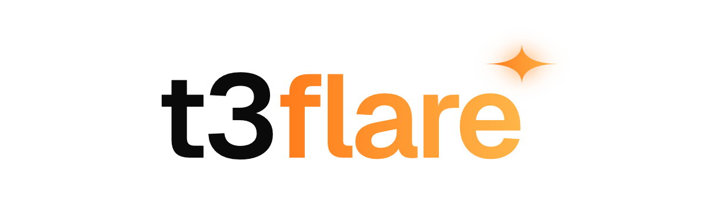

<h1 align="center">
  <picture>
    <source media="(prefers-color-scheme: dark)" srcset="docs/assets/t3flare-logo-dark.png">
    
  </picture>
</h1>

A self-hosted [t3code](https://github.com/pingdotgg/t3code) Environment on Cloudflare: the stock T3 Code clients (web,
desktop, mobile) attach to it like any other Environment, and run coding agents in the cloud beside your laptop.

https://github.com/user-attachments/assets/5dbc7d46-0e75-45ba-b2b1-4526ab2d507d

> **An independent project.** Not affiliated with, endorsed by, or supported by T3 Tools Inc. t3code is theirs;
> t3flare is built on t3code by T3 Tools Inc. and runs it, pinned, as a submodule. Please don't take t3flare's issues
> to the t3code project.

## Status

Experimental. t3flare is one Maintainer's working Deployment, published so others can run their own. It is maintained
on a best-effort basis, with no stability guarantee: `main` is the only supported version, and there are no releases,
tags or changelog. The commit log and the t3 bump pull requests are the record. [`docs/plan.md`](docs/plan.md) has
the milestones done so far.

## What you get

- **A cloud Environment for the stock clients.** Pair the web, desktop or mobile client and work with projects, threads,
  diffs, approvals, terminals and worktrees as t3 shows them; the Environment survives restarts and resets itself when
  idle.
- **Durable agents.** Pi Durable runs in Durable Objects, keeps its turn through a restart, and runs commands in a
  Workspace's Container, started only when needed.
- **CLI agents.** Codex, Claude Code, OpenCode and the pi CLI run in the Workspace's Container, on your Model endpoints,
  with no vendor credential inside it.
- **A laptop link.** Your laptop's T3 Code can delegate a task to a cloud agent and follow it, and a phone notification
  through T3 Connect tells you when a cloud run finishes or waits for you.
- **A Harness panel.** Your Model endpoints, MCP servers and settings in one page, behind Cloudflare Access; agents get
  code mode, tool search and the MCP servers you add.

## How it works

Two Workers ([ADR-0014](docs/adr/0014-two-workers-environment-and-agents.md)). The environment Worker runs t3's server
in one Durable Object, the Environment DO, which the clients reach over a plain WebSocket
([ADR-0002](docs/adr/0002-the-environment-is-one-durable-object-and-clients-connect-over-a-plain-websocket.md)). The
agents Worker holds the Sessions and Workspaces: each Workspace is a Durable Object with a Container it starts on
demand. Every model call goes to a Model endpoint you add, with its key held by the Environment, never by a Container.
t3code is a pinned submodule, changed only by Layers, then Shadows, then Patches
([ADR-0001](docs/adr/0001-t3code-is-a-pinned-submodule-changed-by-layer-then-shadow-then-patch.md)), and an hourly job
proposes each new t3code release on the Deployment's t3 track, stable or nightly, once it passes on a test Stage
([ADR-0041](docs/adr/0041-a-deployment-follows-one-t3-track-set-as-a-deployment-setting.md)).

## Requirements

1. **Cloudflare**: a Workers **Paid** account with **Containers**, and Cloudflare Access (Zero Trust) for the admin
   routes ([ADR-0010](docs/adr/0010-the-endpoint-is-public-behind-t3s-own-auth.md)). A zone in the account for
   `prod`'s hostname. Local Docker, which builds the Container image during a deploy.
2. **A GitHub App** that gives each Workspace a token for its one repository
   ([ADR-0013](docs/adr/0013-github-access-through-a-github-app-with-per-repo-tokens.md)). A setup script registers it
   under your account.
3. **Model access**: an API key for a provider pi-ai speaks (Anthropic, OpenAI, Google, Mistral, or any
   OpenAI-compatible API, including a model proxy you run). You add it as a Model endpoint in the Harness panel after
   the first deploy; no deploy setting holds a model key. [`docs/model-endpoints.md`](docs/model-endpoints.md) is the
   guide.

## Deploy your own

```sh
mise install && pnpm install                               # Node, pnpm; the t3code submodule checked out
cp dev.env.example ~/.config/t3flare/dev.env               # chmod 600, then fill in your Deployment settings
pnpm --filter @t3flare/infra run github-app:setup          # registers your GitHub App
pnpm --filter @t3flare/environment run deploy <stage>      # a throwaway test Stage first
T3FLARE_DOMAIN=t3.example.com pnpm --filter @t3flare/environment run deploy prod
# pair your first client, then add a Model endpoint in the Harness panel
```

[`docs/deploy.md`](docs/deploy.md) is the full guide: every Deployment setting (the source holds none of yours, and
has no defaults), the Cloudflare logins, pairing, and the optional CI that deploys `prod` on every push to `main`.

## Updating

A Deployment runs the commit it was deployed from. Pull this repository's `main` and deploy again. With CI set up in
your Deployment repository, pushing `main` deploys `prod`, and the stock clients' Update buttons work too
([docs/deploy.md, Updating](docs/deploy.md#updating)).

## Cost

At light and moderate use the bill is almost all of Cloudflare's $5 Workers Paid minimum; heavy use (a client connected
around the clock, many turns) is about $35 a month. [`docs/cost.md`](docs/cost.md) has the model and what to watch.

## Privacy

**No product analytics.** Stock t3 sends usage analytics to t3's PostHog (`ingest.t3.codes`) by default. The Cloud
Environment never does: t3flare's built-in managed policy sets t3's `telemetry` limit to off, and t3 then drops every
event, its own and the ones clients relay
([ADR-0023](docs/adr/0023-the-cloud-environment-tells-clients-only-what-it-does.md)). The same policy shows the
settings of features the cloud doesn't do as "Managed by t3flare".

## Third-party agents

The Workspace image's CLI agents are not part of t3flare and are not covered by its licence. Each deploy builds the image
itself, downloading each CLI from its publisher, so by deploying you accept each one's terms. The project never
publishes a prebuilt image ([ADR-0040](docs/adr/0040-the-workspace-image-is-built-by-each-owner-and-never-published.md)).

| Agent | Publisher | Terms |
| --- | --- | --- |
| [Codex CLI](https://github.com/openai/codex) | OpenAI | Apache-2.0 |
| [Claude Code](https://code.claude.com), with the Claude Agent SDK | Anthropic | Proprietary: use is subject to [Anthropic's legal agreements](https://code.claude.com/docs/en/legal-and-compliance) |
| [claude-agent-acp](https://github.com/agentclientprotocol/claude-agent-acp), Claude Code's ACP adapter | Agent Client Protocol | Apache-2.0 |
| [OpenCode](https://github.com/anomalyco/opencode) | Anomaly | MIT |
| [pi](https://github.com/earendil-works/pi) | Earendil Works (Mario Zechner) | MIT |

## Support and contributing

- Questions and ideas: [Discussions](https://github.com/spiritledsoftware/t3flare/discussions).
- Bugs: [Issues](https://github.com/spiritledsoftware/t3flare/issues), using the forms.
- Vulnerabilities: privately, as [`SECURITY.md`](SECURITY.md) says, never in a public issue.
- Changes: [`CONTRIBUTING.md`](CONTRIBUTING.md). Everyone taking part follows the
  [Code of Conduct](CODE_OF_CONDUCT.md).

## Documentation

- Deployers: [`docs/deploy.md`](docs/deploy.md), [`docs/model-endpoints.md`](docs/model-endpoints.md),
  [`docs/cost.md`](docs/cost.md).
- Contributors: [`CONTRIBUTING.md`](CONTRIBUTING.md), [`GLOSSARY.md`](GLOSSARY.md), the decisions in
  [`docs/adr/`](docs/adr/), the platform facts in [`docs/research/`](docs/research/), and
  [`docs/upstream-fragility.md`](docs/upstream-fragility.md) for where following t3code's nightlies breaks t3flare.
- History: [`docs/plan.md`](docs/plan.md), the milestones and what each delivered.

## License

[MIT](LICENSE), Copyright (c) 2026 Spirit-Led Software LLC. Some files come from other projects under their own
licences; [`THIRD_PARTY_NOTICES.md`](THIRD_PARTY_NOTICES.md) lists them.
